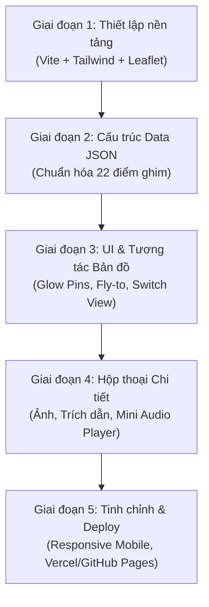

# KẾ HOẠCH DỰ ÁN & TÀI LIỆU YÊU CẦU SẢN PHẨM (PRD)
# DỰ ÁN: "CÂY ĐOÀN KẾT" - WEB BẢN ĐỒ LỊCH SỬ TƯƠNG TÁC
**Môn học:** Tư tưởng Hồ Chí Minh (HCM202) - ĐH FPT  
**Thể loại:** Sản phẩm sáng tạo số / Web bản đồ tương tác (Interactive Storytelling Map)

---

## I. TỔNG QUAN DỰ ÁN (PROJECT OVERVIEW)

### 1. Ý tưởng cốt lõi & Tên gọi
* **Tên sản phẩm:** **Cây Đoàn Kết** (The Tree of Unity) – Bản đồ tương tác Tư tưởng Hồ Chí Minh.
* **Hình thức:** Ứng dụng web bản đồ tương tác (tương tự Google Maps) nhưng các điểm ghim (pins) là những dấu mốc lịch sử sống động về tình đoàn kết.
* **Triết lý chủ đạo:**
  * **Biến lý thuyết thành thị giác:** Thay vì đọc giáo trình khô khan về "Đoàn kết là sức mạnh", người xem nhìn thấy mạng lưới điểm ghim phủ khắp từ buôn làng hẻo lánh, nhà thờ, chùa chiền đến New York, Paris, La Habana, châu Phi.
  * **Khắc họa hai mắt xích không thể tách rời:** 
    1. **Sức mạnh dân tộc** (Nội lực khối đại đoàn kết toàn dân).
    2. **Sức mạnh thời đại** (Sự đồng thuận, ủng hộ của nhân loại tiến bộ).

---

## II. THIẾT KẾ TRẢI NGHIỆM NGƯỜI DÙNG (UX/UI SPECIFICATION)

### 1. Luồng trải nghiệm chính (User Journey)
1. **Truy cập ứng dụng:** Màn hình chào ngắn (Hero Banner) giới thiệu thông điệp *“Một dân tộc đoàn kết là một dân tộc vô địch”* -> Chuyển vào bản đồ toàn màn hình.
2. **Khám phá bản đồ:**
   * Các điểm ghim (Glow Pins) nhấp nháy phát sáng trên nền bản đồ (phong cách thanh lịch, trang nghiêm).
   * Hover/Tap vào điểm ghim: Hiện tooltip tóm tắt (Tên điểm, Quốc gia/Tỉnh thành, Icon phân loại).
3. **Mở hộp thông tin (Detail Sidebar / Bottom Sheet):**
   * Bấm vào pin: Camera bản đồ mượt mà di chuyển (Fly-to) đến tọa độ đó, mở ngăn kéo chi tiết (Drawer/Sidebar):
     * **Ảnh tư liệu lịch sử:** Ảnh chụp sắc nét kèm chú thích gốc.
     * **Trích dẫn tiêu biểu:** 3 - 4 dòng trích dẫn nguyên văn của Bác Hồ (hoặc nhân chứng) kèm năm và xuất xứ.
     * **Audio Player (20 - 30s):** Nghe phát thanh giọng nói của Bác, khẩu hiệu biểu tình, hoặc nhạc tư liệu lịch sử.
     * **Mô tả bối cảnh lịch sử:** 1 - 2 câu súc tích làm nổi bật ý nghĩa tư tưởng đoàn kết.
4. **Bộ chuyển đổi góc nhìn (Perspective Switcher):**
   * **Nút bấm chuyển đổi nhanh 2 chế độ:**
     * 🇻🇳 **Góc nhìn 1: Nước non một nhà** (Bản đồ zoom về Việt Nam; hiện các điểm Dân tộc thiểu số, Tôn giáo, Nhân sĩ trí thức).
     * 🌍 **Góc nhìn 2: Bạn bè năm châu** (Bản đồ mở rộng toàn cầu; hiện các điểm phong trào phản chiến Mỹ, Châu Âu, Cuba, Châu Phi, Phong trào Á - Phi).
   * **Bộ lọc nhánh nhỏ (Sub-filters / Tags):**
     * *Dân tộc thiểu số* | *Tôn giáo* | *Trí thức & Đô thị* | *Mỹ & Châu Âu* | *Cuba & Châu Phi - Mỹ Latinh*.

---

## III. KIẾN TRÚC KỸ THUẬT ĐỀ XUẤT (TECH STACK)

| Thành phần | Công nghệ đề xuất | Lý do lựa chọn |
| :--- | :--- | :--- |
| **Frontend Framework** | **React / Vite** hoặc **Next.js** (hoặc HTML5/JS thuần) | Tải trang cực nhanh, tối ưu trải nghiệm kéo/chạm mượt mà trên mobile. |
| **Bản đồ (Map Engine)** | **Leaflet.js** hoặc **MapLibre GL JS** | Mã nguồn mở 100% miễn phí (không tốn phí API Credit Card như Google Maps), hỗ trợ custom marker phát sáng (Pulse Glow), điều khiển flyTo linh hoạt. |
| **Map Tiles (Giao diện bản đồ)** | **CartoDB Positron** hoặc **OSM Humanitarian** | Tông màu tinh tế, tôn các điểm ghim lịch sử, hiển thị tiếng Việt và tiếng Anh rõ ràng. |
| **Giao diện & Hiệu ứng** | **Tailwind CSS + Lucide Icons + Framer Motion** | Thiết kế thanh lịch, hiện đại, hiệu ứng mở sidebar và play audio sống động. |
| **Media Player** | **HTML5 Audio / Howler.js** hoặc nhúng **YouTube Iframe Mini** | Phát mượt file mp3/tư liệu âm thanh ngắn 20-30 giây. |
| **Triển khai (Deploy)** | **Vercel** hoặc **GitHub Pages** | Miễn phí, 1 click deploy, domain HTTPS chạy ngay trên điện thoại/laptop chấm điểm. |

---

## IV. DATA SCHEMA CHUẨN HÓA (JSON SPECIFICATION)

Mỗi điểm ghim trên bản đồ được cấu trúc hóa theo TypeScript / JSON Schema sau:

```typescript
interface SolidarityPoint {
  id: string;                      // Mã định danh duy nhất (vd: 'dt-pacbo', 'qt-cuba')
  perspective: 'national' | 'international'; // Góc nhìn: 'Nước non một nhà' | 'Bạn bè năm châu'
  category: 'minority' | 'religion' | 'intellectual' | 'west_antiwar' | 'tricontinental'; // Nhóm chủ đề
  title: string;                   // Tên điểm / sự kiện
  locationName: string;           // Tên địa danh (Vd: Pác Bó, Cao Bằng; La Habana, Cuba)
  coordinates: [number, number];   // [Latitude, Longitude]
  year: string;                    // Thời gian/Năm diễn ra (vd: '1941', '1969')
  image: {
    url: string;                   // Đường link ảnh tư liệu
    caption: string;               // Chú thích ảnh
  };
  quote: {
    text: string;                  // Trích dẫn lời Bác hoặc danh ngôn lịch sử
    source: string;                // Nguồn trích dẫn (Tác phẩm, bài nói, năm)
  };
  audio: {
    url: string;                   // File mp3 hoặc link Youtube / archive audio
    label: string;                 // Tên đoạn băng ghi âm / tư liệu
  };
  shortDescription: string;        // 1-2 câu giải thích ý nghĩa cốt lõi
}
```

---

## V. TỔNG HỢP TOÀN BỘ BỘ DỮ LIỆU CHUẨN THEO 4 NHÓM CHỦ ĐỀ

### PHẦN 1: GÓC NHÌN "NƯỚC NON MỘT NHÀ" (ĐOÀN KẾT DÂN TỘC)

#### Nhóm 1.1: Đồng bào Dân tộc thiểu số & Vùng cao (5 điểm)
1. **Pác Bó (Cao Bằng) – Cội nguồn cách mạng và tình cảm đồng bào Việt Bắc**
   * **Tọa độ:** `[22.7089, 106.2631]`
   * **Thời gian:** 1941
   * **Ảnh:** `https://baotanglichsu.vn/DataFiles/Uploaded/image/data%20Hung/thang%205%20nam%202020/Bac%20Ho%20ve%20Pac%20Bo/1.jpg`  
     *Chú thích:* Bác Hồ sống và làm việc tại Pác Bó trong sự che chở của đồng bào các dân tộc Nùng, Tày.
   * **Trích dẫn:** *“Đồng bào Thổ, đồng bào Nùng, đồng bào Mán… người thì giúp chúng tôi ăn, kẻ thì cho chúng tôi áo, bảo bọc chúng tôi như ruột thịt.”* (Hồ Chí Minh: Báo cáo trước Quốc hội, 1953)
   * **Audio:** Ghi âm tư liệu bài nói về đồng bào Việt Bắc (`https://www.youtube.com/watch?v=6hjdQX6mUAo`)
   * **Mô tả ngắn:** Căn cứ địa cách mạng đầu tiên khi Người về nước, minh chứng cho sức mạnh toàn dân khi Đảng và Bác được đồng bào dân tộc thiểu số đùm bọc, chở che.

2. **Pleiku (Gia Lai) – Thư gửi Đại hội các Dân tộc thiểu số miền Nam**
   * **Tọa độ:** `[13.9833, 108.0000]`
   * **Thời gian:** 19/04/1946
   * **Ảnh:** `https://baogialai.com.vn/dataimages/202104/original/images2798606_1.jpg`  
     *Chú thích:* Bức thư lịch sử của Chủ tịch Hồ Chí Minh gửi Đại hội các dân tộc thiểu số miền Nam tại Pleiku.
   * **Trích dẫn:** *“Đồng bào Kinh hay Thổ, Mường hay Mán, Gia Rai hay Ê Đê… đều là con cháu Việt Nam, đều là anh em ruột thịt. Sông có thể cạn, núi có thể mòn, nhưng lòng đoàn kết của chúng ta không bao giờ giảm bớt.”* (Thư gửi Đại hội các Dân tộc thiểu số miền Nam, 19/4/1946)
   * **Audio:** Đoạn ngâm/đọc trích đoạn bức thư lịch sử (`https://www.youtube.com/watch?v=JcvDTy5YMHI`)
   * **Mô tả ngắn:** Bản tuyên ngôn bất hủ khẳng định sự bình đẳng, gắn bó keo sơn không thể chia cắt của các dân tộc anh em trên dải đất Việt Nam.

3. **Thuận Châu (Sơn La) – Bác Hồ thăm đồng bào các dân tộc Tây Bắc**
   * **Tọa độ:** `[21.4278, 103.6769]`
   * **Thời gian:** 07/05/1959
   * **Ảnh:** `https://baosonla.org.vn/uploads/news/2021_05/bac-ho-noi-chuyen-o-thuan-chau.jpg`  
     *Chú thích:* Chủ tịch Hồ Chí Minh nói chuyện với cán bộ, chiến sĩ và nhân dân các dân tộc Tây Bắc tại Kỳ đài Thuận Châu.
   * **Trích dẫn:** *“Ngày nay, tất cả các dân tộc Kinh, Thái, Mường, Mèo… đều là anh em ruột thịt một nhà, cùng nhau thi đua xây dựng bản mường ấm no, hạnh phúc.”* (Lời căn dặn tại Thuận Châu, 7/5/1959)
   * **Audio:** Tư liệu âm thanh Kỳ đài Thuận Châu (`https://www.youtube.com/watch?v=TSOuAPeajZ0`)
   * **Mô tả ngắn:** Chuyến thăm lịch sử sau 5 năm chiến thắng Điện Biên Phủ, thể hiện sự quan tâm sâu sắc của Bác đến đời sống và khối đoàn kết các dân tộc vùng phên dậu Tây Bắc.

4. **Tuyên Quang – Bác Hồ nói chuyện với đại biểu dân tộc thiểu số**
   * **Tọa độ:** `[21.8233, 105.2142]`
   * **Thời gian:** 23/11/1945
   * **Ảnh:** `https://tuyenquang.gov.vn/uploads/images/2020/05/bac-ho-tuyen-quang.jpg`  
     *Chú thích:* Bác Hồ thăm và nói chuyện với các học sinh, đại biểu đồng bào thiểu số vùng chiến khu Tuyên Quang.
   * **Trích dẫn:** *“Đồng bào Kinh và Chính phủ rất thương mến đồng bào Mán, Thổ và coi như anh chị em trong một nhà, phải thương yêu, giúp đỡ nhau cùng tiến bộ.”* (Hồ Chí Minh: Huấn thị ngày 23/11/1945)
   * **Audio:** Bản thu trích lời nói của Bác với đồng bào chiến khu (`https://www.youtube.com/watch?v=6hjdQX6mUAo`)
   * **Mô tả ngắn:** Khẳng định chính sách bình đẳng bác ái giữa các dân tộc ngay từ những tháng ngày đầu tiên của nước Việt Nam Dân chủ Cộng hòa.

5. **Mỹ Bằng (Yên Sơn, Tuyên Quang) – Bác Hồ đến thăm gia đình đồng bào Dao**
   * **Tọa độ:** `[21.8500, 105.2500]`
   * **Thời gian:** 1952
   * **Ảnh:** `https://baotuyenquang.com.vn/file/dataimages/201905/original/images1412586_anh1.jpg`  
     *Chú thích:* Chủ tịch Hồ Chí Minh thân tình thăm hỏi một gia đình người Dao tại xã Mỹ Bằng trong kháng chiến chống Pháp.
   * **Trích dẫn:** *“Cách mạng đã do Việt Bắc mà thành công thì kháng chiến sẽ do Việt Bắc mà thắng lợi.”* (Hồ Chí Minh, Thư gửi đồng bào Việt Bắc, 1952)
   * **Audio:** Ghi âm lời kể của nhân chứng lịch sử gia đình đồng bào Dao.
   * **Mô tả ngắn:** Biểu tượng của sự gần gũi, gắn bó máu thịt giữa vị Lãnh tụ tối cao với từng người dân nghèo vùng đồng bào thiểu số.

---

#### Nhóm 1.2: Tôn giáo & Nhân sĩ Trí thức / Đô thị (5 điểm)
1. **Tòa Giám mục Phát Diệm (Kim Sơn, Ninh Bình) – Bác Hồ với đồng bào Công giáo**
   * **Tọa độ:** `[20.0928, 106.0792]`
   * **Thời gian:** 1945 - 1946
   * **Ảnh:** `https://images.nhandan.vn/nhandan/2021/09/02/bac-ho-va-dong-bao-cong-giao.jpg`  
     *Chú thích:* Chủ tịch Hồ Chí Minh khẳng định tinh thần “Kính Chúa, yêu nước” với các giám mục và bà con giáo dân.
   * **Trích dẫn:** *“Chúa Giêsu dạy ta yêu thương nhân loại, tha thứ kẻ thù… Người Công giáo Việt Nam yêu nước tức là làm sáng danh Thiên Chúa.”* (Thư gửi đồng bào Công giáo nhân dịp Lễ Giáng sinh, 1945)
   * **Audio:** Lời Bác chúc mừng Giáng sinh và hòa hợp tôn giáo.
   * **Mô tả ngắn:** Bác luôn trân trọng tự do tín ngưỡng, khơi dậy tinh thần "sống phúc âm giữa lòng dân tộc", quy tụ đồng bào theo đạo sát cánh cùng kháng chiến.

2. **Chùa Quán Sứ (Hà Nội) – Tinh thần từ bi hộ quốc của Phật giáo Việt Nam**
   * **Tọa độ:** `[21.0255, 105.8458]`
   * **Thời gian:** 1946
   * **Ảnh:** `https://phatgiao.org.vn/images/bac-ho-chua-quan-su.jpg`  
     *Chú thích:* Bác Hồ tiếp các đại biểu Phật giáo tại chùa Quán Sứ, biểu dương tinh thần nhập thế cứu quốc.
   * **Trích dẫn:** *“Phật giáo Việt Nam với dân tộc như hình với bóng, tuy hai mà một. Tinh thần từ bi của Đức Phật hòa quyện với lòng yêu nước của nhân dân ta.”* (Hồ Chí Minh tiếp Tăng ni, 1946)
   * **Audio:** Đoạn nhạc chuông chùa hòa cùng lời nhắn nhủ hòa hợp lương - giáo.
   * **Mô tả ngắn:** Khẳng định tôn giáo và độc lập dân tộc không mâu thuẫn; các vị cao tăng, phật tử cởi áo cà sa khoác chiến bào bảo vệ giang sơn.

3. **Bắc Bộ Phủ (Hà Nội) – Trọng dụng nhân sĩ cựu triều & đại trí thức Tây học**
   * **Tọa độ:** `[21.0261, 105.8564]`
   * **Thời gian:** 1945 - 1946
   * **Ảnh:** `https://baotanglichsu.vn/data/images/Bac-Ho-va-Huynh-Thuc-Khang.jpg`  
     *Chú thích:* Chủ tịch Hồ Chí Minh bên cụ Huỳnh Thúc Kháng – vị chí sĩ yêu nước được Bác trao quyền Quyền Chủ tịch nước năm 1946.
   * **Trích dẫn:** *“Tôi xin đem hết tài mọn giúp Cụ, khi Cụ đi vắng, tôi sẽ 'Dĩ bất biến, ứng vạn biến' để giữ vững nền độc lập.”* (Cụ Huỳnh Thúc Kháng đáp lại sự tin cậy tuyệt đối của Bác Hồ, 1946)
   * **Audio:** Ghi âm tư liệu về lời dặn của Bác với Cụ Huỳnh trước khi đi Pháp.
   * **Mô tả ngắn:** Tầm nhìn đại đoàn kết vượt trên mọi định kiến ý thức hệ: Mời các quan lại triều Nguyễn (Phan Kế Toại, Phạm Khắc Hòe, Bảo Đại) và nhân sĩ cựu trào cùng chung sức gánh vác việc nước.

4. **Khu học xá Trung ương / Việt Bắc – Thu phục các nhà khoa học lỗi lạc hồi hương**
   * **Tọa độ:** `[21.7500, 105.3500]`
   * **Thời gian:** 1946 - 1950
   * **Ảnh:** `https://vusta.vn/upload/tran-dai-nghia-bac-ho.jpg`  
     *Chú thích:* Kỹ sư Trần Đại Nghĩa cùng các trí thức theo Bác từ Paris về chiến khu kháng chiến gian khổ.
   * **Trích dẫn:** *“Trí thức là vốn liếng quý báu của dân tộc. Không có trí thức hợp tác với công nông thì cách mạng không thể thành công.”* (Hồ Chí Minh: Bài nói chuyện với trí thức, 1947)
   * **Audio:** Giọng kể của Giáo sư Trần Đại Nghĩa về ngày gặp Bác quyết định bỏ mức lương cao tại Pháp về nước chế tạo vũ khí.
   * **Mô tả ngắn:** Sức hút nhân cách phi thường của Bác khiến các nhà khoa học đỉnh cao (Trần Đại Nghĩa, Tôn Thất Tùng, Tạ Quang Bửu, Đặng Văn Ngữ) tình nguyện rời chốn phồn hoa lên rừng ăn củ sắn chế súng bazooka cứu nước.

5. **Dinh Độc Lập / Sài Gòn – Tinh thần hòa hợp, hòa giải dân tộc sau ngày giải phóng**
   * **Tọa độ:** `[10.7770, 106.6953]`
   * **Thời gian:** 1975 (Kế thừa tư tưởng Bác)
   * **Ảnh:** `https://nhandan.vn/images/hoa-hop-dan-toc-1975.jpg`  
     *Chú thích:* Cờ đỏ sao vàng tung bay trên nóc Dinh Độc Lập, hiện thực hóa ước nguyện non sông thu về một mối.
   * **Trích dẫn:** *“Nước Việt Nam là một, dân tộc Việt Nam là một. Sông có thể cạn, núi có thể mòn, song chân lý ấy không bao giờ thay đổi.”* (Hồ Chí Minh: Tuyên bố tháng 2/1946)
   * **Audio:** Tiếng reo hò của đồng bào Sài Gòn ngày 30/4/1975 và giọng Bác đọc Tuyên ngôn Độc lập.
   * **Mô tả ngắn:** Đỉnh cao của sự nghiệp đoàn kết toàn dân: Khép lại quá khứ chiến tranh, triệu trái tim người Việt cùng chung một mái nhà độc lập thống nhất.

---

### PHẦN 2: GÓC NHÌN "BẠN BÈ NĂM CHÂU" (ĐOÀN KẾT QUỐC TẾ)

#### Nhóm 2.1: Phong trào phản chiến & Nhân dân Mỹ – Châu Âu (6 điểm)
1. **Washington D.C. (Mỹ) – Biểu tình Moratorium chống chiến tranh Việt Nam**
   * **Tọa độ:** `[38.8895, -77.0353]` (Tượng đài Washington & National Mall)
   * **Thời gian:** 15/11/1969
   * **Ảnh:** `https://cdn.kienthuc.net.vn/images/xHPT4F6wca3CCetM_-9zPIUfnNJLmxPNHX0t6HL5aH0LpSciznqk_QWcbzzF188PrF3vDWW4MYWk3cHdj3i7SWJlrHuhvk9eUtLUVB-fMPG4gP8IZL-YgjEyYIxrDi8cDP9rTOFveAvkWMXJx7iXhw/anh-cuc-hiem-lan-song-bieu-tinh-phan-doi-chien-tranh-viet-nam-Hinh-2.jpeg.avif`  
     *Chú thích:* Hơn 500.000 người Mỹ biểu tình tuần hành tại Washington D.C đòi chấm dứt chiến tranh ở Việt Nam.
   * **Trích dẫn:** *“Tôi sẽ thay mặt nhân dân ta đi thăm và cảm ơn… các nước bầu bạn khắp năm châu đã tận tình ủng hộ và giúp đỡ cuộc chống Mỹ, cứu nước của nhân dân ta.”* (Di chúc Hồ Chí Minh, 1969)
   * **Audio:** Tiếng hô hào chống chiến tranh từ sự kiện Moratorium 1969 (`https://www.youtube.com/watch?v=he4-R846-0A`)
   * **Mô tả ngắn:** Cuộc biểu tình phản chiến lớn nhất lịch sử nước Mỹ, biểu tượng của sự thức tỉnh lương tri nhân loại đứng về phía chính nghĩa Việt Nam.

2. **New York (Mỹ) – Tuần hành Central Park đến Liên Hợp Quốc & Tiếng nói Martin Luther King Jr.**
   * **Tọa độ:** `[40.7829, -73.9654]` (Central Park, New York)
   * **Thời gian:** 15/04/1967
   * **Ảnh:** `https://upload.wikimedia.org/wikipedia/commons/thumb/e/e6/Vietnam_War_protesters_at_the_March_on_the_Pentagon.jpg/800px-Vietnam_War_protesters_at_the_March_on_the_Pentagon.jpg`  
     *Chú thích:* 400.000 người dưới sự dẫn dắt của Martin Luther King Jr. tuần hành phản chiến.
   * **Trích dẫn:** *“Nhân dân Mỹ và nhân dân Việt Nam không thù không oán… chúng tôi luôn mong muốn có quan hệ hữu nghị và hòa bình với các bạn.”* (Hồ Chí Minh: Thư gửi nhân dân Mỹ, 12/1961)
   * **Audio:** Trích đoạn diễn văn chống chiến tranh của Martin Luther King Jr. ("Beyond Vietnam", 1967)
   * **Mô tả ngắn:** Cuộc tuần hành gắn kết cuộc đấu tranh dân quyền của người da màu và sinh viên Mỹ với phong trào giải phóng dân tộc Việt Nam.

3. **UC Berkeley, California (Mỹ) – Trái tim phong trào sinh viên phản chiến**
   * **Tọa độ:** `[37.8696, -122.2589]` (Sproul Plaza, Berkeley)
   * **Thời gian:** 1965 - 1969
   * **Ảnh:** `https://upload.wikimedia.org/wikipedia/commons/d/dd/Berkeley_Vietnam_protest_1965.jpg`  
     *Chú thích:* Sinh viên trường Đại học UC Berkeley tụ tập phản chiến tại quảng trường Sproul Plaza.
   * **Trích dẫn:** *“Nhân dân Việt Nam phân biệt rất rõ nhân dân Mỹ yêu chuộng hòa bình với những thế lực hiếu chiến gây ra chiến tranh.”* (Hồ Chí Minh: Báo Nhân Dân, 1968)
   * **Audio:** Giai điệu phản chiến bất hủ "Give Peace a Chance" - John Lennon (`https://www.youtube.com/watch?v=6jO9YLwPCjg`)
   * **Mô tả ngắn:** Tiêu biểu cho làn sóng trí thức trẻ phương Tây dũng cảm đối diện với chính phủ để bảo vệ lẽ phải cho một dân tộc cách xa nửa vòng trái đất.

4. **Trafalgar Square, Luân Đôn (Anh) – Tiếng nói hòa bình của nhân dân Vương quốc Anh**
   * **Tọa độ:** `[51.5080, -0.1281]` (Trafalgar Square, London)
   * **Thời gian:** 1968
   * **Ảnh:** `https://upload.wikimedia.org/wikipedia/commons/thumb/c/cf/London_Vietnam_demonstration_1968.jpg/800px-London_Vietnam_demonstration_1968.jpg`  
     *Chú thích:* Hàng vạn người dân Anh biểu tình tại quảng trường Trafalgar mang theo biểu ngữ phản đối chiến tranh.
   * **Trích dẫn:** *“Quan sơn muôn dặm một nhà / Bốn phương vô sản đều là anh em.”* (Hồ Chí Minh)
   * **Audio:** Âm thanh đoàn người tuần hành phản đối chiến tranh tại London (Tư liệu BBC/Pathé).
   * **Mô tả ngắn:** Một trong những trung tâm vận động hòa bình quốc tế lớn nhất châu Âu, khẳng định sự cô lập về mặt ngoại giao của các thế lực xâm lược.

5. **Stockholm (Thụy Điển) – Cuộc tuần hành đuốc của Thủ tướng Olof Palme**
   * **Tọa độ:** `[59.3325, 18.0644]` (Stockholm, Thụy Điển)
   * **Thời gian:** 21/02/1968
   * **Ảnh:** `https://upload.wikimedia.org/wikipedia/commons/8/87/Olof_Palme_Vietnam_1968.jpg`  
     *Chú thích:* Olof Palme (sau này là Thủ tướng Thụy Điển) cầm đuốc tuần hành cùng Đại sứ Việt Nam Nguyễn Thọ Chân.
   * **Trích dẫn:** *“Sự đoàn kết quốc tế có một ý nghĩa vô cùng to lớn đối với chúng tôi.”* (Hồ Chí Minh)
   * **Audio:** Bài phát biểu chấn động của Olof Palme phản đối ném bom Hà Nội (`https://www.youtube.com/watch?v=vGm4es5rJnQ`)
   * **Mô tả ngắn:** Sự kiện chấn động ngoại giao toàn cầu: Lãnh đạo cấp cao một nước phương Tây công khai xuống đường ủng hộ Việt Nam, đưa Thụy Điển trở thành ngọn cờ đoàn kết châu Âu.

6. **Paris (Pháp) – Tình bạn thủy chung giữa Bác Hồ và phong trào tiến bộ Pháp**
   * **Tọa độ:** `[48.8566, 2.3522]` (Paris, Pháp)
   * **Thời gian:** 1946 & 1968 - 1973
   * **Ảnh:** `https://baotanglichsu.vn/DataFiles/Uploaded/image/Aubrac-Ho-Chi-Minh-1946.jpg`  
     *Chú thích:* Bác Hồ tại tư gia người bạn Pháp Raymond Aubrac (1946) và các cuộc mít-tinh ủng hộ Hiệp định Paris.
   * **Trích dẫn:** *“Nhân dân Việt Nam không bao giờ nhầm lẫn nước Pháp của Tự do - Bình đẳng - Bác ái với những kẻ thực dân áp bức. Chúng tôi luôn coi nhân dân Pháp là những người bạn tốt.”* (Hồ Chí Minh: Trả lời họp báo tại Paris, 1946)
   * **Audio:** Tiếng hô vang khẩu hiệu đoàn kết Việt - Pháp trên đường phố Paris.
   * **Mô tả ngắn:** Paris vừa là nơi Bác gieo hạt giống hữu nghị nhân dân đầu tiên, vừa là trung tâm phong trào cánh tả châu Âu bảo bọc phái đoàn đàm phán của ta.

---

#### Nhóm 2.2: Cuba, Châu Phi, Châu Á & Khối Vô sản Quốc tế (6 điểm)
1. **La Habana (Cuba) – Điểm hẹn của tình anh em cách mạng xuyên đại dương**
   * **Tọa độ:** `[23.1136, -82.3666]` (La Habana, Cuba)
   * **Thời gian:** 1960 - 1966
   * **Ảnh:** `https://baotuyenquang.com.vn/file/dataimages/201910/original/images1449963_images1904942_1.jpg`  
     *Chú thích:* Chủ tịch Hồ Chí Minh đón tiếp nồng hậu các đoàn khách hữu nghị Cuba; Ủy ban đoàn kết với miền Nam Việt Nam của Melba Hernández.
   * **Trích dẫn:** *“Việt Nam và Cuba cách xa nhau hàng vạn dặm, nhưng lòng dạ hai nước chúng ta gần gũi như anh em một nhà.”* (Hồ Chí Minh, Hồ Chí Minh Toàn tập, tập 15, 1966)
   * **Audio:** Giai điệu hào hùng “Guantanamera” và câu nói lịch sử của Fidel: *“Vì Việt Nam, Cuba sẵn sàng hiến dâng cả máu của mình!”*
   * **Mô tả ngắn:** Biểu tượng mẫu mực của tình đoàn kết quốc tế vô sản trong sáng giữa hai dân tộc cùng chung lý tưởng giải phóng con người.

2. **Conakry (Guinea, Tây Phi) – Bác Hồ với phong trào giải phóng dân tộc châu Phi**
   * **Tọa độ:** `[9.6412, -13.5784]` (Conakry, Guinea)
   * **Thời gian:** 1960
   * **Ảnh:** `https://images.hcmcpv.org.vn//Uploads/Image/0505202118988A32/05-05-2021Bac_2.jpg`  
     *Chú thích:* Bác Hồ nồng nhiệt đón Tổng thống Ahmed Sékou Touré tại sân bay Gia Lâm (1960).
   * **Trích dẫn:** *“Nhân dân Việt Nam và nhân dân các nước châu Phi là những người bạn cùng chung cảnh ngộ, cùng chung mục tiêu đấu tranh chống chủ nghĩa đế quốc và thực dân để giành độc lập, tự do.”* (Hồ Chí Minh: Điện mừng Hội nghị nhân dân Á - Phi, 1960)
   * **Audio:** Tư liệu diễn văn chào mừng tình đoàn kết Á - Phi (`https://www.youtube.com/watch?v=v4LcJKYR3Vk`)
   * **Mô tả ngắn:** Khắc họa vai trò tiên phong của Bác trong việc truyền cảm hứng, liên kết cuộc đấu tranh của nhân dân thuộc địa châu Phi với cách mạng Việt Nam.

3. **New Delhi (Ấn Độ) – Nhịp cầu văn hóa và phong trào Không liên kết phương Đông**
   * **Tọa độ:** `[28.6139, 77.2090]` (New Delhi, Ấn Độ)
   * **Thời gian:** 1958
   * **Ảnh:** `https://vpdf.org.vn/upload/2001187/20210813/phat-huy-suc-manh-mem-kinh-nghiem-tu-viet-nam-va-an-do_1_92cd7.jpg`  
     *Chú thích:* Chủ tịch Hồ Chí Minh hội đàm thân mật cùng Thủ tướng Ấn Độ Jawaharlal Nehru.
   * **Trích dẫn:** *“Tình hữu nghị giữa nhân dân Việt Nam và nhân dân Ấn Độ đã có từ lâu đời, được xây dựng trên nền tảng hiểu biết lẫn nhau và cùng yêu chuộng hòa bình.”* (Hồ Chí Minh: Diễn văn mít tinh New Delhi, 1958)
   * **Audio:** Bản thu hòa tấu nhạc cụ truyền thống Ấn - Việt và diễn từ của Bác tại New Delhi.
   * **Mô tả ngắn:** Ngoại giao hòa hiếu phương Đông và tư tưởng hòa bình gắn liền với phong trào Không liên kết (Non-Aligned Movement).

4. **Moskva (Liên Xô / Nga) – Khởi nguồn lý tưởng đoàn kết vô sản thế giới**
   * **Tọa độ:** `[55.7558, 37.6173]` (Điện Kremlin, Moskva)
   * **Thời gian:** 1924
   * **Ảnh:** `https://baotanglichsu.vn/DataFiles/Uploaded/image/data%20Hung/thang%206%20nam%202014/Dai%20hoi%20lan%20thu%20V%20quoc%20te%20cong%20san%20tai%20Matcova/1.jpg`  
     *Chú thích:* Người thanh niên yêu nước Nguyễn Ái Quốc phát biểu tại Đại hội Quốc tế Cộng sản lần thứ V (1924).
   * **Trích dẫn:** *“Chỉ có chủ nghĩa xã hội, chủ nghĩa cộng sản mới giải phóng được các dân tộc bị áp bức và những người lao động trên thế giới khỏi ách nô lệ.”* (Hồ Chí Minh: Con đường dẫn tôi đến chủ nghĩa Lênin, 1960)
   * **Audio:** Trích đoạn hành khúc Quốc tế ca (The Internationale).
   * **Mô tả ngắn:** Dấu mốc lịch sử đưa cách mạng giải phóng dân tộc Việt Nam hòa vào dòng chảy của phong trào công nhân và vô sản quốc tế.

5. **Hội nghị Ba Lục Địa Tricontinental (La Habana) – Mặt trận Á – Phi – Mỹ Latinh**
   * **Tọa độ:** `[23.1226, -82.3865]` (Hội trường Tricontinental, La Habana)
   * **Thời gian:** 15/01/1966
   * **Ảnh:** `https://upload.wikimedia.org/wikipedia/commons/thumb/d/d4/OSPAAAL_poster.jpg/600px-OSPAAAL_poster.jpg`  
     *Chú thích:* Hội nghị Tricontinental năm 1966 – diễn đàn đoàn kết của 82 quốc gia với Việt Nam.
   * **Trích dẫn:** *“Nhân dân Việt Nam đang chiến đấu không chỉ cho độc lập của mình mà còn cho độc lập của tất cả các dân tộc bị áp bức trên thế giới.”* (Tuyên bố chung Hội nghị Ba Lục Địa, 1966)
   * **Audio:** Bài phát biểu đanh thép của Fidel Castro tại lễ bế mạc Hội nghị Ba Lục Địa (1966).
   * **Mô tả ngắn:** Mặt trận đoàn kết chống đế quốc quy mô liên lục địa lớn nhất lịch sử, xem thắng lợi của Việt Nam là thắng lợi chung của nhân loại tiến bộ.

6. **Bắc Kinh & Quảng Châu (Trung Quốc) – "Vừa là đồng chí, vừa là anh em"**
   * **Tọa độ:** `[39.9042, 116.4074]` (Bắc Kinh, Trung Quốc)
   * **Thời gian:** 1925 - 1960
   * **Ảnh:** `https://baochinhphu.vn/Images/2019/12/bac-ho-va-chu-an-lai.jpg`  
     *Chú thích:* Bác Hồ gặp gỡ Thủ tướng Chu Ân Lai và các lãnh đạo nhân dân Trung Quốc.
   * **Trích dẫn:** *“Mối tình thắm thiết Việt - Hoa / Vừa là đồng chí, vừa là anh em.”* (Hồ Chí Minh)
   * **Audio:** Bài hát hữu nghị Việt - Trung thập niên 1950.
   * **Mô tả ngắn:** Đại diện cho hậu phương lớn xã hội chủ nghĩa, tương trợ lẫn nhau trong sự nghiệp đấu tranh giải phóng dân tộc và xây dựng đất nước.

---

## VI. LỘ TRÌNH KỸ THUẬT TRIỂN KHAI DỰ ÁN (DEV ROADMAP)



### Chi tiết các bước thực hiện:
1. **Bước 1 - Khởi tạo Project:**
   * Tạo repo React/Vite hoặc Single Page Web App.
   * Cài đặt Leaflet / React-Leaflet, Lucide-react, Tailwind CSS.
2. **Bước 2 - Tạo file dữ liệu `solidarityData.json`:**
   * Nhúng toàn bộ 22 điểm đã chuẩn hóa ở Mục V vào dự án.
3. **Bước 3 - Xây dựng Component Bản đồ:**
   * Thiết kế Icon ghim phát sáng (CSS pulsing glow ring).
   * Viết hàm chuyển đổi Camera: Khi bấm nút *“Nước non một nhà”* -> Zoom tọa độ Việt Nam `[16.0, 107.5]`, zoom level 6. Khi bấm *“Bạn bè năm châu”* -> Zoom thế giới `[20.0, 10.0]`, zoom level 2.5.
4. **Bước 4 - Xây dựng Drawer / Sidebar đa phương tiện:**
   * Component Audio Player có thanh tiến trình, nút Play/Pause 20-30s.
   * Modal phóng to ảnh và hiển thị trích dẫn trang trọng.
5. **Bước 5 - Kiểm thử & Báo cáo:**
   * Thử nghiệm trên cả điện thoại (cảm ứng vuốt) và máy tính (chuột click).
   * Đóng gói mã nguồn và chuẩn bị thuyết trình môn HCM202.
